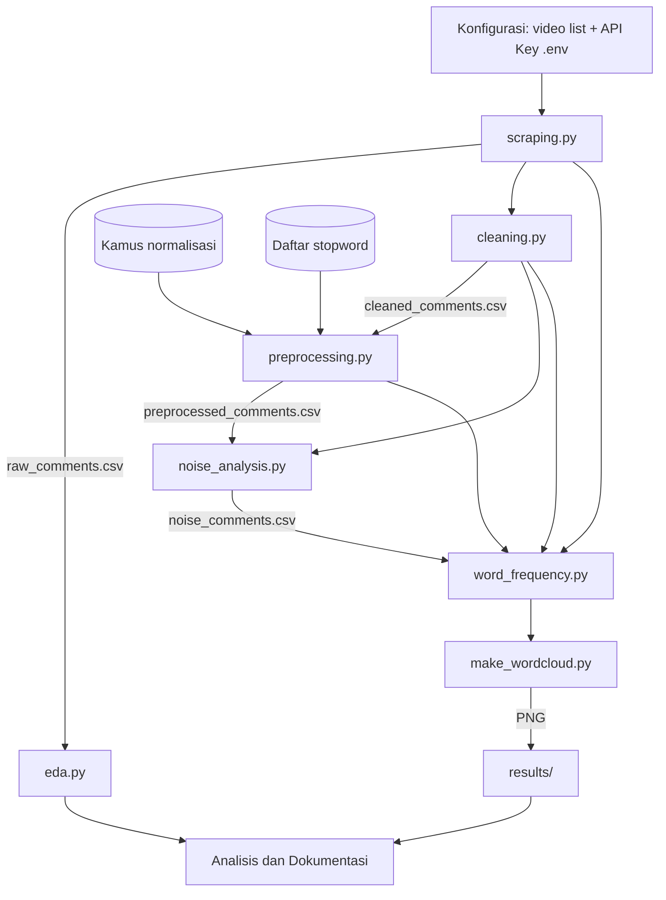

# Arsitektur Sistem: Analisis Komentar YouTube tentang AI

Dokumen ini menjelaskan rancangan teknis pipeline text mining yang mengacu pada `PRD.md`.

---

## 1. Gambaran Umum

Sistem berupa pipeline batch berbasis Python. Setiap tahap membaca file dari tahap sebelumnya dan menulis file baru, sehingga setiap hasil bisa diperiksa sebelum lanjut.



## 2. Arsitektur Berlapis

| Lapisan | Komponen | Tanggung jawab |
|---|---|---|
| Sumber data | YouTube Data API v3 | Menyediakan komentar publik |
| Akuisisi | `scraping/scraping.py` | Mengambil, deduplikasi, dan menyimpan komentar mentah |
| Pemrosesan | `preprocessing/cleaning.py`, `normalization.py`, `preprocessing.py` | Cleaning dan preprocessing teks |
| Analisis | `analysis/eda.py`, `noise_analysis.py`, `word_frequency.py` | Statistik, deteksi noise, frekuensi kata |
| Visualisasi | `visualization/make_wordcloud.py` | WordCloud dan bar chart |
| Penyimpanan | `dataset/`, `results/` | File CSV dan PNG |
| Konfigurasi | `.env`, `requirements.txt` | API Key dan dependensi |

## 3. Struktur Folder

```
PROJECT-ML-YOUTUBE/
├── config/
│   └── videos.txt
├── dataset/
│   ├── raw_comments.csv
│   ├── cleaned_comments.csv
│   ├── preprocessed_comments.csv
│   └── noise_comments.csv
├── scraping/
│   └── scraping.py
├── preprocessing/
│   ├── cleaning.py
│   ├── normalization.py
│   ├── normalization_dict.csv
│   ├── stopwords_id.txt
│   ├── stem_exceptions.csv
│   ├── protected_words.py
│   └── preprocessing.py
├── analysis/
│   ├── eda.py
│   ├── noise_analysis.py
│   └── word_frequency.py
├── visualization/
│   ├── make_wordcloud.py
│   └── wordcloud_excludes.txt
├── results/
│   ├── word_frequencies.csv
│   ├── top_20_words.csv
│   ├── wordcloud_raw.png
│   ├── wordcloud_cleaned.png
│   ├── wordcloud_preprocessed.png
│   ├── wordcloud_noise.png
│   └── top_20_words.png
├── workflow/
│   ├── make_workflow.py
│   └── workflow.png
├── notebook/
│   └── analysis.ipynb
├── requirements.txt
├── .env.example
├── .gitignore
├── README.md
└── LAPORAN.md
```

Catatan penamaan: modul visualisasi akhirnya diberi nama `visualization/make_wordcloud.py` (bukan `wordcloud.py`) agar tidak membayangi library `wordcloud` saat `import wordcloud`. Ini keputusan final Phase 7.

## 4. Spesifikasi Modul

### 4.1 `scraping/scraping.py`

| Aspek | Rincian |
|---|---|
| Input | Daftar URL/Video ID dari `config/videos.txt`, `YOUTUBE_API_KEY` dari `.env`, target jumlah komentar (`--target` atau `TARGET_COMMENTS`) |
| Proses | Ekstrak Video ID → panggil `commentThreads.list` (`part=snippet`, `maxResults=100`) → ikuti `nextPageToken` → deduplikasi `comment_id` (termasuk terhadap CSV run sebelumnya) → simpan progres per video → lanjut ke video berikutnya sampai target |
| Output | `dataset/raw_comments.csv` (UTF-8) |
| Error ditangani | `HttpError` 403 (komentar nonaktif atau kuota), 404 (video tidak ada), error jaringan (retry terbatas) |
| Log | Jumlah komentar per video dan total unik |

Fungsi utama (rencana):
- `extract_video_id(url_or_id)`
- `fetch_comments(youtube, video_id, max_needed)`
- `collect_all(video_list, target)`
- `save_csv(df, path)`

### 4.2 `analysis/eda.py`
- Input: `raw_comments.csv`
- Proses: jumlah baris, nilai kosong, duplikat, panjang karakter dan kata, contoh komentar, histogram, indikasi noise (regex URL, mention, emoji)
- Output: ringkasan di konsol dan grafik distribusi panjang (disimpan di `results/`)

### 4.3 `preprocessing/cleaning.py`
- Input: `raw_comments.csv`
- Urutan: case folding → hapus URL → hapus mention → hapus simbol hashtag → hapus emoji → hapus angka → hapus tanda baca dan karakter tidak perlu → rapikan spasi → buang komentar kosong → buang duplikat teks
- Output: `cleaned_comments.csv` (kolom `text_cleaned`)
- Fitur tambahan: fungsi `show_before_after(n)` untuk perbandingan

### 4.4 `preprocessing/normalization.py`
- Memuat kamus normalisasi (dictionary kata tidak baku → baku) dari file yang dapat diedit manual (misalnya `normalization_dict.csv` atau dictionary di modul)
- Fungsi: `load_dictionary()`, `normalize_tokens(tokens)`
- Aturan: kata yang tidak ada di kamus dibiarkan apa adanya

### 4.5 `preprocessing/preprocessing.py`
- Input: `cleaned_comments.csv`
- Urutan: tokenization → normalisasi → stopword removal → stemming Sastrawi
- Pengaman: daftar `PROTECTED_WORDS` (misalnya istilah AI) yang tidak dihapus sebagai stopword dan tidak di-stem
- Pengecualian stemming: `stem_exceptions.csv` memetakan kata ke bentuk akhir tanpa di-stem
  (mis. `perkembangan`, `perusahaan`, `setuju`/`tujuan`) agar makna tidak melebur
- Optimasi: cache hasil stemming per kata agar proses cepat
- Output: `preprocessed_comments.csv`

### 4.6 `analysis/noise_analysis.py`
- Input: raw, cleaned, preprocessed
- Aturan deteksi (rencana): komentar kosong setelah cleaning, rasio simbol/emoji tinggi, URL, karakter berulang berlebihan, komentar sangat pendek tanpa informasi, teks identik berulang (spam)
- Output: label noise per komentar, perbandingan statistik sebelum/sesudah, `dataset/noise_comments.csv` (data pendukung WordCloud noise)

### 4.7 `analysis/word_frequency.py`
- Input: teks dari tiap tahap
- Proses: tokenisasi sederhana, `collections.Counter`
- Output: tabel frekuensi per tahap (dipakai `make_wordcloud.py` dan bar chart Top 20)

### 4.8 `visualization/make_wordcloud.py`
- Input: frekuensi kata per tahap (`results/word_frequencies.csv`), daftar kata yang dikecualikan dari gambar (`visualization/wordcloud_excludes.txt`)
- Proses: `WordCloud.generate_from_frequencies()` → Matplotlib → simpan PNG
- Output: `wordcloud_raw.png`, `wordcloud_cleaned.png`, `wordcloud_preprocessed.png`, `wordcloud_noise.png`, `top_20_words.png`
- Parameter: 2400×1500 px, maks 200 kata, hanya kata dengan frekuensi ≥ 2, `random_state=42` agar reproducible
- Filter visual: kata di `wordcloud_excludes.txt` tidak digambar, tetapi tetap ada di dataset dan tabel frekuensi
- Syarat: judul, ukuran jelas, background kontras, data dari dataset nyata

### 4.9 `workflow/make_workflow.py`
- Input: dataset CSV, file konfigurasi (kamus/stopword/pengecualian), dan tabel frekuensi
- Proses: membaca angka nyata → Matplotlib (kartu tahap + panah alur) → PNG
- Output: `workflow/workflow.png` (2400×1500 px)
- Isi: Phase 2–7 plus dokumentasi Phase 9, dengan input/output dan metrik tiap tahap
- Prinsip: tidak ada angka hardcode; diagram ikut berubah bila data berubah

### 4.10 `LAPORAN.md` dan `notebook/analysis.ipynb` (Phase 9)
- `LAPORAN.md`: 13 bagian, dari pendahuluan sampai kesimpulan dan saran; seluruh angka mengacu pada output program
- `notebook/analysis.ipynb`: membaca dataset dan file ringkasan, menampilkan statistik, Top 20, WordCloud, dan workflow
- Notebook tidak menjalankan ulang scraping atau stemming; tujuannya menyajikan hasil yang sudah diverifikasi
- `README.md`: instalasi, pembuatan API key, urutan eksekusi, opsi perintah, dan troubleshooting

## 5. Aliran Data dan Skema

| Tahap | File | Kolom utama |
|---|---|---|
| Raw | `raw_comments.csv` | `video_id, comment_id, author, text, published_at, like_count` |
| Cleaned | `cleaned_comments.csv` | raw + `text_cleaned` |
| Preprocessed | `preprocessed_comments.csv` | cleaned + `tokens`, `tokens_normalized`, `tokens_no_stopword`, `text_preprocessed` |
| Noise | `noise_comments.csv` | `comment_id`, `video_id`, `text`, `text_cleaned`, `text_preprocessed`, `noise_type`, `jumlah_label` |

Kunci penghubung antar file: `comment_id`.

## 6. Konfigurasi dan Keamanan

- `.env` berisi `YOUTUBE_API_KEY=...` (tidak dikomit).
- `.env.example` berisi `YOUTUBE_API_KEY=isi_api_key_anda`.
- `.gitignore` memuat minimal: `.env`, `__pycache__/`, `.ipynb_checkpoints/`.
- Di Google Colab, gunakan `getpass` atau Secrets agar key tidak tertulis di notebook.
- Pertimbangkan pembatasan API Key (hanya YouTube Data API v3) di Google Cloud Console.

## 7. Dependensi (`requirements.txt`)

```
google-api-python-client
pandas
numpy
Sastrawi
nltk
matplotlib
wordcloud
python-dotenv
```

Catatan: NLTK dipakai hanya jika diperlukan (misalnya tokenizer atau stopword tambahan); daftar stopword Indonesia dari Sastrawi dapat dipakai sebagai dasar.

## 8. Urutan Eksekusi

Dijalankan dari root proyek:

```bash
pip install -r requirements.txt
python scraping/scraping.py
python analysis/eda.py
python preprocessing/cleaning.py
python preprocessing/preprocessing.py
python analysis/noise_analysis.py
python analysis/word_frequency.py
python visualization/make_wordcloud.py
python workflow/make_workflow.py
```

Setiap langkah diperiksa hasilnya sebelum melanjutkan ke langkah berikutnya.

## 9. Penanganan Error dan Logging

| Skenario | Penanganan |
|---|---|
| API Key tidak ditemukan | Hentikan dengan pesan jelas |
| Kuota API habis | Simpan komentar yang sudah terkumpul, beri tahu pengguna |
| Komentar video dinonaktifkan | Lewati video, catat di log |
| File input tahap sebelumnya tidak ada | Pesan error yang menunjuk tahap yang harus dijalankan lebih dulu |
| Dataset kosong setelah cleaning | Peringatan dan hentikan tahap berikutnya |

Logging menggunakan modul `logging` standar dengan keluaran ke konsol (opsional ke file).

## 10. Keputusan Desain

| Keputusan | Alasan |
|---|---|
| Pipeline berbasis file CSV antar tahap | Mudah diperiksa manual, sesuai aturan "periksa dulu sebelum lanjut" |
| API resmi YouTube Data API v3 | Stabil, sah, sesuai permintaan tugas |
| Sastrawi untuk stemming | Dirancang untuk Bahasa Indonesia, ringan untuk skala mahasiswa |
| Kamus normalisasi eksternal | Dapat diperbarui tanpa mengubah kode |
| Daftar kata terlindungi | Menjaga istilah penting topik AI dari stopword dan stemming |
| Tanpa model ML | Sesuai batasan tugas; fokus text mining dan visualisasi |

## 11. Batasan Arsitektur

- Hanya komentar top-level; balasan (replies) tidak diambil kecuali diputuskan lain.
- Hanya satu bahasa target (Indonesia); komentar berbahasa lain diperlakukan sebagai noise atau dicatat sebagai batasan.
- Pemrosesan batch lokal, tanpa database atau layanan cloud.
