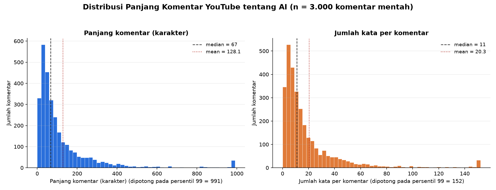
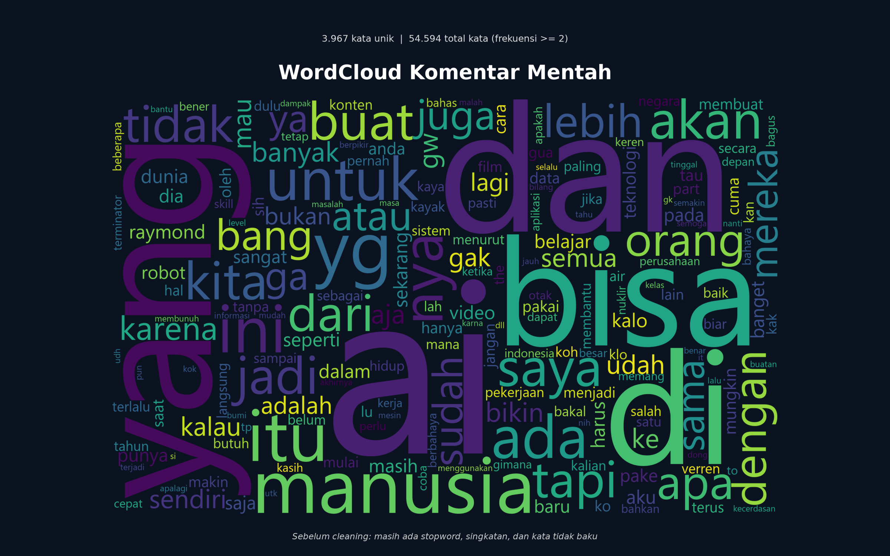
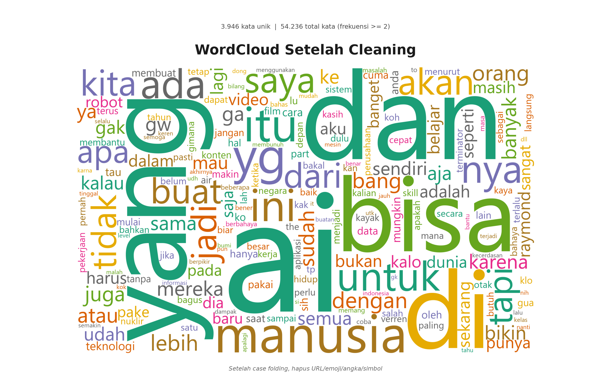
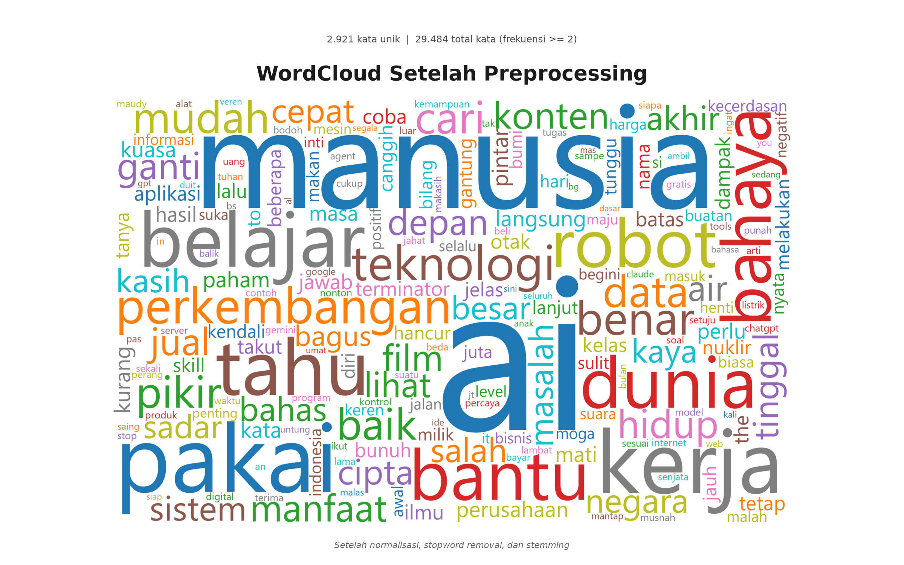
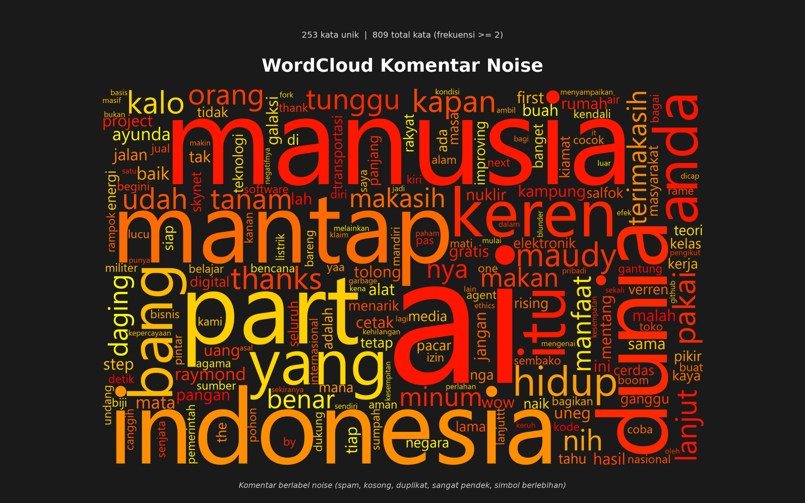
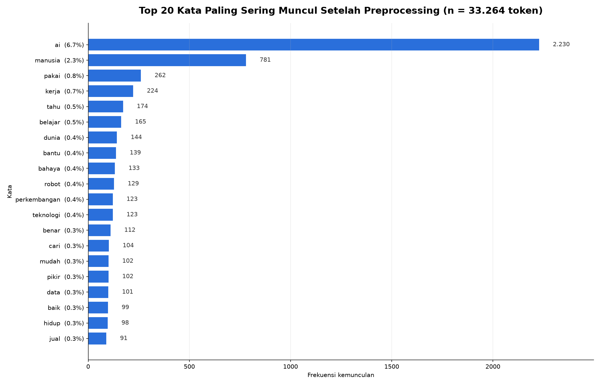
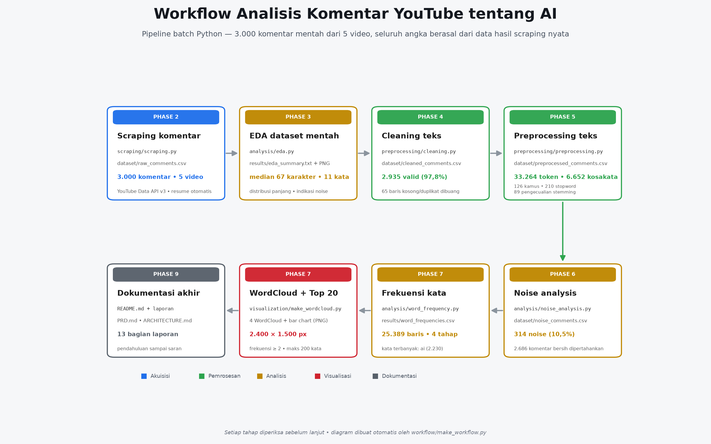

# Laporan Akhir: Analisis Komentar YouTube tentang Artificial Intelligence Menggunakan Text Mining dan WordCloud

| Item | Keterangan |
|---|---|
| Mata kuliah | Machine Learning |
| Jenis tugas | Tugas kelompok |
| Objek data | Komentar publik YouTube berbahasa Indonesia bertopik AI |
| Jumlah data | 3.000 komentar mentah dari 5 video |
| Bahasa data | Indonesia (dengan sedikit campuran Inggris dan Melayu) |
| Tools utama | Python, YouTube Data API v3, pandas, Sastrawi, WordCloud, Matplotlib |
| Dokumen acuan | `PRD.md`, `ARCHITECTURE.md`, `README.md` |

**Daftar isi**

1. [Pendahuluan](#1-pendahuluan)
2. [Landasan Teori](#2-landasan-teori)
3. [Metodologi](#3-metodologi)
4. [Pengumpulan Data](#4-pengumpulan-data)
5. [Exploratory Data Analysis (EDA)](#5-exploratory-data-analysis-eda)
6. [Data Cleaning](#6-data-cleaning)
7. [Text Preprocessing](#7-text-preprocessing)
8. [Analisis Noise](#8-analisis-noise)
9. [Analisis Frekuensi Kata](#9-analisis-frekuensi-kata)
10. [Visualisasi WordCloud dan Top 20](#10-visualisasi-wordcloud-dan-top-20)
11. [Workflow Sistem](#11-workflow-sistem)
12. [Pembahasan](#12-pembahasan)
13. [Kesimpulan dan Saran](#13-kesimpulan-dan-saran)

---

## 1. Pendahuluan

### 1.1 Latar belakang

Artificial Intelligence (AI) telah menjadi salah satu topik paling ramai dibicarakan di internet. Setiap video tentang AI di YouTube hampir selalu menghasilkan ratusan hingga ribuan komentar. Komentar tersebut memuat opini, harapan, kekhawatiran, pengalaman pribadi, pertanyaan, candaan, hingga promosi. Bagi manusia, membaca dan merangkum ribuan komentar secara manual memakan waktu dan mudah tidak konsisten.

Komentar YouTube termasuk teks tidak terstruktur. Di dalamnya terdapat singkatan (`bgt`, `yg`, `gak`), bahasa gaul (`gue`, `banget`), emoji, URL, mention, hashtag, angka, tanda baca berulang, dan spam. Sebelum dapat dianalisis, teks seperti ini perlu dibersihkan dan dinormalisasi. Text mining menyediakan rangkaian metode untuk mengubah teks mentah menjadi data yang lebih teratur, lalu merangkumnya melalui frekuensi kata dan visualisasi.

Proyek ini membangun pipeline text mining untuk menjawab pertanyaan sederhana namun terukur: **kata apa yang paling sering muncul ketika orang Indonesia membicarakan AI di kolom komentar YouTube?** Hasil akhirnya berupa dataset bersih, tabel frekuensi, WordCloud, grafik Top 20, diagram workflow, dan laporan ini.

### 1.2 Rumusan masalah

1. Bagaimana mengumpulkan minimal 2.000 komentar YouTube bertopik AI secara sah dan reproducible?
2. Bagaimana karakteristik dataset mentah, terutama panjang komentar dan indikasi noise?
3. Bagaimana membersihkan dan memproses teks berbahasa Indonesia tanpa menghilangkan istilah penting tentang AI?
4. Berapa proporsi noise struktural dan bagaimana perbandingan data sebelum dan sesudah noise removal?
5. Kata apa yang paling sering muncul setelah preprocessing, dan bagaimana hasilnya divisualisasikan?
6. Bagaimana merangkai seluruh tahap menjadi workflow yang dapat dijalankan ulang dan didokumentasikan?

### 1.3 Tujuan

1. Mengumpulkan 3.000 komentar publik dari video YouTube berbahasa Indonesia bertopik AI menggunakan YouTube Data API v3.
2. Menyimpan dataset mentah dan setiap hasil tahap dalam file CSV UTF-8.
3. Melakukan EDA untuk memahami ukuran, kelengkapan, dan indikasi noise pada data mentah.
4. Melakukan cleaning, normalisasi, stopword removal, dan stemming Sastrawi.
5. Mengidentifikasi noise struktural serta membandingkan statistik sebelum dan sesudahnya.
6. Menghitung frekuensi kata dan membuat WordCloud untuk empat tahap serta bar chart Top 20.
7. Menyusun diagram workflow dan dokumentasi akhir yang dapat dipresentasikan.

### 1.4 Manfaat

- **Akademik:** menjadi contoh penerapan text mining Bahasa Indonesia dari hulu ke hilir, termasuk penanganan kata tidak baku dan stemming yang agresif.
- **Praktis:** menunjukkan cara mengubah komentar publik menjadi ringkasan visual yang mudah dibaca.
- **Teknis:** menyediakan pipeline modular yang dapat dijalankan ulang, diperiksa per tahap, dan dikembangkan untuk topik lain.

### 1.5 Batasan

- Hanya komentar **top-level** yang diambil; balasan komentar tidak termasuk.
- Hanya menggunakan **YouTube Data API v3**, bukan scraping HTML atau library tidak resmi.
- Analisis dibatasi pada **frekuensi kata dan visualisasi**, bukan sentiment analysis, klasifikasi, atau training model.
- Data diambil dari 5 video yang dipilih berdasarkan kriteria tertentu, sehingga hasil tidak mewakili seluruh populasi pengguna YouTube Indonesia.
- Tidak ada deployment aplikasi web atau dashboard.

---

## 2. Landasan Teori

### 2.1 Text mining

Text mining adalah proses menemukan pola, informasi, atau pengetahuan dari data teks tidak terstruktur. Berbeda dengan data numerik, teks perlu diubah terlebih dahulu menjadi representasi yang dapat dihitung, misalnya daftar token atau frekuensi kata. Pada proyek ini, representasi yang dipakai adalah **bag of words sederhana**: setiap komentar diubah menjadi kumpulan kata, lalu dihitung berapa kali setiap kata muncul.

### 2.2 Tahapan preprocessing teks

1. **Case folding** — mengubah seluruh huruf menjadi huruf kecil agar `AI`, `Ai`, dan `ai` dianggap sama.
2. **Pembersihan noise** — menghapus URL, mention, hashtag, emoji, angka, tanda baca, dan spasi berlebih.
3. **Tokenization** — memecah teks menjadi token/kata.
4. **Normalisasi** — mengubah kata tidak baku menjadi bentuk baku menggunakan kamus, misalnya `gak` → `tidak`, `bgt` → `banget`.
5. **Stopword removal** — membuang kata yang tidak membawa makna topik, seperti `yang`, `dan`, `di`, `itu`.
6. **Stemming** — memotong kata berimbuhan ke bentuk dasar, misalnya `membantu` → `bantu` dan `bekerja` → `kerja`. Pada proyek ini dipakai Sastrawi, stemmer khusus Bahasa Indonesia.

### 2.3 Frekuensi kata dan WordCloud

Frekuensi kata dihitung dengan menghitung kemunculan setiap token. Kata dengan frekuensi tertinggi dianggap paling menonjol dalam korpus. WordCloud memetakan frekuensi tersebut menjadi ukuran huruf: semakin sering sebuah kata muncul, semakin besar tampilannya. WordCloud berguna sebagai ringkasan visual cepat, tetapi tetap perlu didampingi tabel frekuensi agar tidak menyesatkan. Karena itu proyek ini juga menghasilkan bar chart Top 20 yang memiliki skala eksplisit.

### 2.4 Alat dan library

| Kebutuhan | Alat/library |
|---|---|
| Pengambilan data | YouTube Data API v3, `google-api-python-client` |
| Pengolahan tabel | `pandas`, `numpy` |
| Stemming Bahasa Indonesia | `Sastrawi` |
| Visualisasi | `matplotlib`, `wordcloud` |
| Konfigurasi rahasia | `python-dotenv` |
| Bahasa pemrograman | Python 3.13.4 (diuji; kompatibel Python 3.9+) |

---

## 3. Metodologi

### 3.1 Jenis penelitian

Penelitian ini bersifat **deskriptif kuantitatif** dengan data sekunder berupa komentar publik YouTube. Tidak ada variabel target dan tidak ada model prediktif. Fokusnya adalah mengukur karakteristik teks dan merangkum kata yang dominan.

### 3.2 Rancangan pipeline

Pipeline dirancang **batch dan berbasis file**. Setiap tahap membaca file hasil tahap sebelumnya, memprosesnya, lalu menulis file baru. Pemisahan ini sengaja dilakukan agar setiap hasil dapat diperiksa sebelum tahap berikutnya dijalankan, sesuai aturan kerja proyek.

| Fase | Aktivitas | Input utama | Output utama |
|---|---|---|---|
| 2 | Scraping komentar | `config/videos.txt`, `.env` | `dataset/raw_comments.csv` |
| 3 | EDA | `raw_comments.csv` | `results/eda_summary.txt`, histogram |
| 4 | Cleaning | `raw_comments.csv` | `dataset/cleaned_comments.csv` |
| 5 | Preprocessing | `cleaned_comments.csv`, kamus, stopword | `dataset/preprocessed_comments.csv` |
| 6 | Noise analysis | raw, cleaned, preprocessed | `dataset/noise_comments.csv` |
| 7 | Frekuensi kata | semua dataset | `results/word_frequencies.csv`, `top_20_words.csv` |
| 7 | Visualisasi | tabel frekuensi | 4 WordCloud + bar chart Top 20 |
| 8 | Workflow | dataset + konfigurasi | `workflow/workflow.png` |
| 9 | Dokumentasi | seluruh hasil | laporan ini dan `README.md` |

### 3.3 Prinsip kerja

- **Satu modul, satu tanggung jawab.** Scraping, cleaning, preprocessing, analisis, dan visualisasi berada di file terpisah.
- **Konfigurasi dapat diedit tanpa mengubah kode.** Kamus normalisasi, stopword, dan pengecualian stemming disimpan sebagai file teks/CSV.
- **Reproducible.** Semua path relatif terhadap root proyek dan urutan eksekusi didokumentasikan di `README.md`.
- **Tidak ada angka hardcode di dokumentasi.** Setiap angka di laporan ini diambil dari output program dan file hasil.
- **Keamanan API key.** Key hanya dibaca dari `.env`, tidak pernah ditulis di kode atau notebook.

---

## 4. Pengumpulan Data

### 4.1 Sumber dan kriteria pemilihan video

Video dipilih dengan kriteria:

1. Berbahasa Indonesia.
2. Topik utama tentang AI, penggunaan AI, atau dampaknya.
3. Kanal besar dengan jumlah komentar memadai.
4. Komentar publik dan aktif.
5. Memberikan sudut pandang yang cukup beragam: tutorial praktis, edukasi, dan opini.

Lima video yang dipakai berasal dari empat video Raymond Chin dan satu video Kok Bisa?. Empat video cadangan disiapkan di `config/videos.txt`, tetapi tidak diperlukan karena target 3.000 komentar sudah tercapai.

### 4.2 Mekanisme pengambilan data

Scraper memanggil endpoint `commentThreads.list` dengan parameter `part=snippet`, `maxResults=100`, dan `order=relevance`. Setiap halaman menghasilkan maksimal 100 komentar. Jika tersedia `nextPageToken`, scraper mengambil halaman berikutnya. Komentar disimpan dengan kolom:

| Kolom | Keterangan |
|---|---|
| `video_id` | ID video sumber |
| `comment_id` | ID unik komentar, dipakai sebagai kunci deduplikasi |
| `author` | Nama kanal pengomentar |
| `text` | Isi komentar mentah |
| `published_at` | Waktu komentar dibuat (ISO 8601) |
| `like_count` | Jumlah like komentar |

Progres disimpan setiap selesai satu video, sehingga proses aman dihentikan dan dilanjutkan. Duplikat dibuang berdasarkan `comment_id`, termasuk terhadap hasil run sebelumnya. Jika kuota habis, scraper berhenti dengan exit code `2`; jika target belum tercapai, exit code `3`.

### 4.3 Hasil pengumpulan

| Video ID | Kanal | Judul | Komentar | Total like |
|---|---|---|---:|---:|
| `Ewp4tgJG1sY` | Raymond Chin | AI Akan Membunuh Manusia di 2030 | 992 | 2.165 |
| `avUsTRL5XS0` | Raymond Chin | Bodoh AI ke Mahir Dalam 30 Menit Part 1 | 711 | 2.870 |
| `8Lz530r09WU` | Raymond Chin | Tutorial Cari 100jt Dari AI untuk Pemula | 530 | 2.867 |
| `_FcHPrRY5zg` | Kok Bisa? | AI Sama Sekali Enggak Seperti yang Kalian Kira | 430 | 3.393 |
| `L1WaVEi7ePI` | Raymond Chin | 5 Tools AI Bikin Kerjaan 5x Lebih Cepet | 337 | 1.473 |
| **Total** | | | **3.000** | **12.768** |

Seluruh 3.000 baris memiliki `comment_id` unik. Rentang waktu komentar adalah **14 September 2022 sampai 23 November 2026**. Distribusi per tahun: 2022 (282), 2023 (316), 2024 (108), 2025 (40), dan 2026 (2.254). Dominasi tahun 2026 wajar karena sebagian besar video yang dipilih berusia relatif baru saat scraping dilakukan.

Statistik like komentar: rata-rata 4,26; median 0; maksimum 874. Sebanyak 2.313 komentar tidak memiliki like. Komentar dengan like terbanyak adalah pertanyaan retoris *"Keahlian apa yang bikin kalian lebih jago daripada AI?"* dengan 874 like. Ini menunjukkan bahwa komentar singkat dan memancing diskusi dapat memperoleh engagement tinggi, sehingga like tidak dapat dijadikan satu-satunya ukuran kepentingan komentar.

### 4.4 Etika dan keamanan

- Data yang diambil adalah komentar publik dan dipakai untuk tujuan akademik.
- Tidak ada data pribadi sensitif yang dianalisis; nama kanal pengomentar tetap tersimpan sebagai atribut dataset mentah.
- API key disimpan di `.env`, masuk `.gitignore`, dan tidak pernah ditampilkan di laporan, kode, atau notebook.
- Penggunaan kuota efisien: satu halaman komentar berbiaya 1 unit dari kuota gratis 10.000 unit/hari.

---

## 5. Exploratory Data Analysis (EDA)

EDA dilakukan pada `dataset/raw_comments.csv` sebelum cleaning. Tujuannya memahami bentuk data dan memperkirakan masalah yang akan muncul.

### 5.1 Kelengkapan data

| Pemeriksaan | Hasil |
|---|---:|
| Jumlah baris | 3.000 |
| `comment_id` unik | 3.000 |
| Duplikat berdasarkan `comment_id` | 0 |
| Video unik | 5 |
| `video_id` kosong | 0 |
| `comment_id` kosong | 0 |
| `author` kosong | 0 |
| `text` kosong | 1 |
| `like_count` kosong | 0 |
| Teks identik dengan `comment_id` berbeda | 26 |

Kolom wajib sudah terisi. Satu komentar memiliki teks kosong, dan 26 komentar memiliki teks identik meskipun ID-nya berbeda. Duplikat teks ini nantinya dibuang pada tahap cleaning.

### 5.2 Distribusi panjang komentar

| Metrik | Karakter | Kata |
|---|---:|---:|
| Minimum | 0 | 0 |
| Kuartil 1 | 34 | 6 |
| Median | 67 | 11 |
| Rata-rata | 128,1 | 20,3 |
| Kuartil 3 | 144 | 23 |
| Maksimum | 2.399 | 333 |
| Standar deviasi | 189,7 | 28,5 |

Sebanyak 123 komentar memiliki panjang kurang dari 10 karakter, dan 113 komentar lebih dari 500 karakter. Distribusinya miring ke kanan: mayoritas komentar pendek, tetapi ada sedikit komentar sangat panjang yang menaikkan rata-rata. Median 67 karakter lebih representatif daripada rata-rata 128,1 karakter.



### 5.3 Distribusi per video

| Video ID | Komentar | Rata-rata karakter | Rata-rata kata |
|---|---:|---:|---:|
| `Ewp4tgJG1sY` | 992 | 173 | 27 |
| `avUsTRL5XS0` | 711 | 72 | 12 |
| `8Lz530r09WU` | 530 | 141 | 23 |
| `_FcHPrRY5zg` | 430 | 143 | 22 |
| `L1WaVEi7ePI` | 337 | 74 | 12 |

Video bertema opini/dampak AI (`Ewp4tgJG1sY`) menghasilkan komentar paling banyak sekaligus paling panjang. Video tutorial cenderung mendapat komentar lebih pendek, misalnya ucapan terima kasih atau pertanyaan singkat.

### 5.4 Indikasi noise

| Indikator | Jumlah | Persentase |
|---|---:|---:|
| Mengandung URL | 3 | 0,1% |
| Mengandung mention (`@`) | 6 | 0,2% |
| Mengandung hashtag (`#`) | 9 | 0,3% |
| Mengandung emoji | 694 | 23,1% |
| Mengandung angka | 671 | 22,4% |
| Simbol berulang (3+) | 310 | 10,3% |
| Teks kosong | 1 | 0,0% |
| Sangat pendek (< 3 kata) | 207 | 6,9% |
| Teks duplikat | 26 | 0,9% |

Emoji adalah indikator noise yang paling umum, diikuti angka dan simbol berulang. URL, mention, dan hashtag justru sangat sedikit. Ini menunjukkan bahwa dataset relatif bersih dari spam tautan, tetapi kaya akan ekspresi non-verbal.

### 5.5 Temuan EDA

1. Data mentah lengkap secara struktural, tanpa duplikat `comment_id`.
2. Panjang komentar sangat bervariasi; komentar pendek mendominasi.
3. Emoji dan simbol berulang perlu ditangani agar tidak mengganggu tokenisasi.
4. Kata informal tidak dianggap noise pada EDA karena penanganannya dilakukan melalui kamus normalisasi, bukan penghapusan.
5. Ada 26 teks identik yang perlu dipertimbangkan saat deduplikasi.

---

## 6. Data Cleaning

### 6.1 Urutan langkah

Cleaning mengikuti urutan tetap agar hasil konsisten:

1. Case folding.
2. Hapus URL.
3. Hapus mention.
4. Hapus simbol hashtag (kata di belakang `#` dipertahankan).
5. Hapus emoji.
6. Hapus angka.
7. Hapus tanda baca dan simbol non-latin.
8. Rapikan spasi, newline, dan karakter tak terlihat.
9. Buang komentar kosong.
10. Buang duplikat teks setelah cleaning.

Kata tidak baku **tidak dihapus** pada tahap ini. Kata seperti `gak`, `bgt`, dan `gue` dipertahankan agar dapat dinormalisasi pada tahap berikutnya.

### 6.2 Dampak setiap langkah

| Langkah | Teks berubah | Menjadi kosong |
|---|---:|---:|
| Case folding | 2.459 | 1 |
| Hapus URL | 3 | 2 |
| Hapus mention | 6 | 3 |
| Hapus simbol hashtag | 9 | 3 |
| Hapus emoji | 694 | 19 |
| Hapus angka | 668 | 20 |
| Hapus tanda baca & simbol | 2.334 | 22 |
| Rapikan spasi | 1.573 | 22 |

### 6.3 Pembuangan baris

| Pemeriksaan | Jumlah |
|---|---:|
| Baris awal | 3.000 |
| Dibuang karena kosong setelah cleaning | 22 |
| Dibuang karena teks duplikat | 43 |
| Baris akhir | **2.935** |
| Persentase dipertahankan | **97,8%** |

Jumlah duplikat setelah cleaning (43) lebih besar daripada duplikat teks mentah (26) karena variasi teks yang berbeda sebelum cleaning dapat berubah menjadi teks yang sama setelah emoji, angka, dan tanda baca dihapus. Contohnya dua komentar yang hanya berbeda emoji akan menjadi identik.

### 6.4 Perbandingan sebelum dan sesudah

| Metrik | Sebelum | Sesudah |
|---|---:|---:|
| Jumlah komentar | 3.000 | 2.935 |
| Rata-rata karakter | 128,1 | 125,0 |
| Rata-rata kata | 20,3 | 20,3 |
| Komentar tanpa huruf | 0 | 0 |

Pemeriksaan akhir menunjukkan **0 sisa URL, 0 sisa emoji, 0 sisa angka, dan 0 sisa simbol**. Artinya aturan cleaning bekerja sesuai rancangan.

### 6.5 Contoh sebelum dan sesudah

| Sebelum | Sesudah |
|---|---|
| `AI hanyalah AI, dia tidak punya perasaan atau kesadaran selayaknya manusia. Maka, mustahil untuk AI melawan manusia...` | `ai hanyalah ai dia tidak punya perasaan atau kesadaran selayaknya manusia maka mustahil untuk ai melawan manusia...` |
| `Ai bikin bodoh sih 😂,bikin fungsi dari kepala berkurang 😂` | `ai bikin bodoh sih bikin fungsi dari kepala berkurang` |
| `100jutanya itu dari kalian yang pada nonton ini 😆😆🙂‍↕️😆` | `jutanya itu dari kalian yang pada nonton ini` |
| `Mantap banget insgightnya` | `mantap banget insgightnya` |

Contoh terakhir sengaja dipertahankan. `insgightnya` adalah salah ketik, bukan noise struktural. Perbaikannya diserahkan ke kamus normalisasi jika kata tersebut cukup sering muncul. Prinsip ini mencegah cleaning membuang terlalu banyak variasi bahasa alami.

---

## 7. Text Preprocessing

### 7.1 Sumber daya yang dipakai

| Komponen | Jumlah | File |
|---|---:|---|
| Kamus normalisasi | 126 entri | `preprocessing/normalization_dict.csv` |
| Stopword | 210 kata | `preprocessing/stopwords_id.txt` |
| Istilah terlindungi | 36 istilah | `preprocessing/protected_words.py` |
| Pengecualian stemming | 89 kata | `preprocessing/stem_exceptions.csv` |

Kamus normalisasi memetakan kata tidak baku ke bentuk baku. Contoh: `gak` → `tidak`, `bgt` → `banget`, `yg` → `yang`. Karena berbentuk file CSV, kamus dapat ditambah tanpa mengubah kode.

Stopword berisi kata fungsi dan kata diskursus yang tidak membawa makna topik, seperti `yang`, `dan`, `di`, `tidak`, `itu`, `saya`, `tersebut`, `sebenarnya`, dan `menurutku`. Kata dasar `rasa` juga dijadikan stopword karena terlalu umum dan tidak spesifik topik. Namun bentuk turunannya (`terasa`, `merasa`, `merasakan`, `rasakan`, `rasanya`, `berasa`, `perasaan`) dipertahankan agar makna kalimat tidak hilang.

Istilah terlindungi mencakup kata penting tentang AI yang tidak boleh dibuang sebagai stopword dan tidak boleh dirusak stemming, misalnya `ai`, `robot`, `data`, `teknologi`, `chatgpt`, dan istilah teknis lain. Daftar lengkapnya ada di `preprocessing/protected_words.py`.

### 7.2 Tokenization dan normalisasi

Tokenization dilakukan dengan memecah teks bersih berdasarkan spasi. Karena tanda baca sudah dihapus pada tahap cleaning, proses ini sederhana dan cepat. Setiap token kemudian dicocokkan dengan kamus normalisasi. Kata yang tidak ada di kamus dibiarkan apa adanya.

Sebanyak **4.527 token** berubah karena kamus normalisasi. Jumlah token total tidak berubah pada tahap ini karena normalisasi hanya mengganti bentuk kata, bukan menghapusnya.

### 7.3 Stopword removal

Stopword removal membuang kata yang ada di daftar stopword dan token dengan panjang satu huruf. Pengecualian: token yang termasuk `PROTECTED_WORDS` selalu dipertahankan.

Sebanyak **25.327 token** dibuang pada tahap ini. Stopword removal adalah tahap yang paling agresif menurunkan jumlah token, dari 59.635 menjadi 34.308 token.

### 7.4 Stemming dan pengecualian

Stemming memakai Sastrawi. Karena Sastrawi lambat pada ribuan kata unik, diterapkan tiga optimasi:

1. Stemming hanya dilakukan untuk **kata unik**, bukan setiap kemunculan.
2. Proses diparalelkan dengan maksimal 12 worker.
3. Hasil disimpan di `preprocessing/stem_cache.json`, sehingga run berikutnya hampir instan.

Sastrawi terkadang terlalu agresif. Contoh masalah yang ditemukan:

| Kata asli | Hasil Sastrawi | Masalah |
|---|---|---|
| `perkembangan` | `kembang` | Makna bergeser dari proses menjadi bunga |
| `perusahaan` | `usaha` | Makna bergeser dari entitas menjadi kegiatan |
| `setuju` / `tujuan` | `tuju` | Dua kata berbeda melebur |
| `keputusan` | `putus` | Makna bergeser |
| `pengalaman` | `alam` | Makna bergeser |
| `bagian` | `bagi` | Makna bergeser |

Karena itu dibuat `stem_exceptions.csv` berisi 89 kata yang dipetakan langsung ke bentuk akhir tanpa di-stem. Pengecualian diperiksa sebelum cache, sehingga mengedit file ini langsung berpengaruh pada run berikutnya.

### 7.5 Statistik per tahap

| Tahap | Total token | Rata-rata per komentar | Kosakata |
|---|---:|---:|---:|
| Token awal | 59.635 | 20,3 | 8.997 |
| Setelah normalisasi | 59.635 | 20,3 | 8.884 |
| Setelah stopword | 34.308 | 11,7 | 8.660 |
| Setelah stemming | **33.264** | **11,3** | **6.652** |

Perubahan kosakata dari 8.997 menjadi 6.652 menunjukkan bahwa normalisasi dan stemming berhasil menyatukan variasi bentuk kata. Rata-rata token per komentar turun dari 20,3 menjadi 11,3, sehingga data menjadi lebih padat dan berfokus pada kata bermakna.

Setelah stemming, masih ada **1.044 token** yang dibuang karena hasil stemming memunculkan bentuk stopword atau kata tidak baku baru. Contoh: `menggunakan` → `guna`, lalu `guna` dibuang jika ada di stopword. Ada **20 komentar (0,68%)** yang tidak menyisakan kata setelah seluruh proses. Komentar ini tetap disimpan dan ditandai pada noise analysis.

Cache stemming berisi **8.667 kata unik** (8.666 kata lama + 1 kata baru pada run terakhir).

### 7.6 Contoh proses per tahap

**Contoh 1**

| Tahap | Hasil |
|---|---|
| Token | `terlalu → banyak → informasi → di → kepala → sekarang → justru → seperti → orang → linglung → tanpa → arah → jalan → di → tempat` |
| Normalisasi | `terlalu → banyak → informasi → di → kepala → sekarang → justru → seperti → orang → linglung → tanpa → arah → jalan → di → tempat` |
| Tanpa stopword | `informasi → kepala → linglung → arah → jalan → tempat` |
| Stemming | `informasi → kepala → linglung → arah → jalan → tempat` |

**Contoh 2**

| Tahap | Hasil |
|---|---|
| Token | `orang → nemu → tambang → emas → gak → bakal → teriak → teriak → kalau → ada → orang → bilang → ada → tambang → emas → berarti → tambang → emasnya` |
| Normalisasi | `orang → temu → tambang → emas → tidak → akan → teriak → teriak → kalau → ada → orang → bilang → ada → tambang → emas → berarti → tambang → emasnya` |
| Tanpa stopword | `temu → tambang → emas → teriak → teriak → bilang → tambang → emas → berarti → tambang → emasnya` |
| Stemming | `temu → tambang → emas → teriak → teriak → bilang → tambang → emas → arti → tambang → emas` |

**Contoh 3**

| Tahap | Hasil |
|---|---|
| Token | `bahkan → menonton → dan → komen → disinipun → sudah → menjadi → bagian → dari → cari → jt → nya → raymond` |
| Normalisasi | `bahkan → menonton → dan → komen → disinipun → sudah → menjadi → bagian → dari → cari → jt → nya → raymond` |
| Tanpa stopword | `menonton → komen → disinipun → bagian → cari → jt` |
| Stemming | `tonton → komen → sini → bagian → cari → jt` |

### 7.7 Pemeriksaan kualitas

| Pemeriksaan | Hasil |
|---|---:|
| Sisa stopword di hasil akhir | 0 |
| Sisa karakter aneh | 0 |
| Sisa kata tidak baku | 0 |
| Token akhir | 33.264 |
| Kosakata akhir | 6.652 |

Beberapa kata yang sebelumnya bermasalah kini bernilai 0 di hasil akhir, antara lain `kembang`, `asa`, `tuju`, `sin`, `ternyata`, `selama`, `sebuah`, dan `tersebut`. Sementara itu, `perkembangan` tetap muncul 123 kali dan `teknologi` 123 kali, menunjukkan bahwa istilah penting tidak rusak.

---

## 8. Analisis Noise

### 8.1 Pendekatan

Noise analysis pada proyek ini bersifat **struktural**, bukan gaya bahasa. Komentar dinilai noise jika secara struktur tidak memberi informasi yang cukup untuk analisis kata, misalnya kosong, duplikat, hanya emoji, terlalu pendek, atau didominasi simbol. Kata informal seperti `gak`, `bgt`, atau `gue` **tidak dianggap noise** karena masih membawa makna dan dapat dinormalisasi.

Analisis dijalankan pada seluruh 3.000 komentar mentah, termasuk yang gugur saat cleaning, agar jumlahnya transparan. Satu komentar dapat memiliki lebih dari satu label.

### 8.2 Aturan deteksi

| Label | Aturan ringkas |
|---|---|
| Kosong setelah cleaning | Tidak ada huruf/teks tersisa |
| Duplikat teks | Teks sama dengan komentar sebelumnya |
| Tanpa kata informatif | Tidak ada token tersisa setelah preprocessing |
| Terlalu pendek | Hanya 0–1 kata informatif |
| Spam/promosi | Pola ajakan ke channel lain, jualan, judi/pinjol, nomor telepon |
| Karakter berulang | Karakter yang sama diulang 5 kali atau lebih |
| Kata berulang | Satu kata mendominasi ≥ 40% token atau rasio unik < 0,35 |
| Simbol berlebihan | Rasio simbol/emoji ≥ 35% dari panjang teks |

### 8.3 Hasil per jenis noise

| Jenis noise | Jumlah | % total |
|---|---:|---:|
| Kosong setelah cleaning | 22 | 0,7% |
| Duplikat teks | 43 | 1,4% |
| Tanpa kata informatif | 20 | 0,7% |
| Terlalu pendek (≤ 1 kata informatif) | 175 | 5,8% |
| Spam/promosi | 0 | 0,0% |
| Karakter berulang | 58 | 1,9% |
| Kata berulang | 1 | 0,0% |
| Simbol berlebihan | 11 | 0,4% |

Total komentar unik berlabel noise adalah **314 (10,5%)**, sedangkan **2.686 (89,5%)** komentar dianggap bersih. Tidak ditemukan spam promosi pada dataset ini, yang mengindikasikan data relatif bersih. Jenis noise terbanyak adalah komentar terlalu pendek, diikuti karakter berulang dan duplikat teks.

### 8.4 Perbandingan sebelum dan sesudah noise removal

| Metrik | Sebelum | Sesudah |
|---|---:|---:|
| Jumlah komentar | 3.000 | 2.686 |
| Rata-rata kata mentah | 20,3 | 21,8 |
| Total kata informatif | 33.264 | 32.310 |
| Kosakata informatif | 6.652 | 6.458 |
| Rata-rata kata informatif | 11,1 | 12,0 |

Setelah noise removal, rata-rata kata per komentar justru naik. Ini masuk akal karena komentar yang dibuang sebagian besar sangat pendek. Kosakata turun 194 kata, menunjukkan bahwa noise menyumbang sebagian kecil variasi kata yang tidak informatif.

### 8.5 Contoh noise

| Jenis | Contoh |
|---|---|
| Kosong setelah cleaning | `🔥🔥🔥`, `😮` |
| Duplikat teks | `Menarik`, `Keren` |
| Tanpa kata informatif | `Belom😂`, `V3` |
| Terlalu pendek | `Thanks bgt ko raymond`, `First min` |
| Karakter berulang | `Mantaaaaaapppp...........` |
| Kata berulang | `Ini itu... Ini itu.... Ini itu... 🫢🤔` |
| Simbol berlebihan | `Wow❤❤❤` |

### 8.6 Interpretasi

Temuan paling penting adalah **kata informal bukan penyebab utama noise**. Sebagian besar noise berasal dari komentar yang secara struktural terlalu pendek atau tidak memiliki kata informatif. Emoji memang muncul di 23,1% komentar, tetapi emoji tidak otomatis membuat komentar menjadi noise; banyak komentar panjang dan bermakna juga mengandung emoji. Karena itu, penghapusan emoji pada cleaning sudah cukup, tanpa perlu membuang seluruh komentar tersebut.

Dataset noise disimpan di `dataset/noise_comments.csv` (314 baris) dan dipakai untuk WordCloud noise. Dataset utama tidak diubah, sehingga analisis frekuensi tetap dapat memakai 2.935 baris hasil cleaning.

---

## 9. Analisis Frekuensi Kata

### 9.1 Metode

Frekuensi dihitung dengan `collections.Counter` untuk empat tahap:

- **raw:** kata alfabet dari teks mentah.
- **cleaned:** kata dari `text_cleaned` dengan panjang minimal 2.
- **preprocessed:** kata dari `text_preprocessed`, yaitu hasil akhir setelah normalisasi, stopword removal, dan stemming.
- **noise:** kata dari 314 komentar noise. Jika komentar gugur saat cleaning dan tidak punya `text_preprocessed`, dipakai `text_cleaned` sebagai fallback.

Tokenisasi raw memakai regex `[a-z]{2,}` sehingga emoji, angka, dan tanda baca tidak dihitung sebagai kata. Karena itu jumlah token raw pada tabel frekuensi (59.664) sedikit berbeda dari jumlah token awal pada preprocessing (59.635), yang memakai pemecahan berdasarkan spasi setelah teks dibersihkan. Perbedaan ini hanya soal definisi token, bukan perbedaan data.

### 9.2 Statistik per tahap

| Tahap | Komentar | Total kata | Kata unik |
|---|---:|---:|---:|
| Raw | 3.000 | 59.664 | 8.988 |
| Cleaned | 2.935 | 59.312 | 8.973 |
| Preprocessed | 2.935 | 33.264 | 6.652 |
| Noise | 314 | 1.332 | 776 |

### 9.3 Kata terbanyak pada data mentah dan cleaned

| Peringkat | Raw | Frekuensi | Cleaned | Frekuensi |
|---:|---|---:|---|---:|
| 1 | ai | 2.236 | ai | 2.230 |
| 2 | dan | 1.115 | dan | 1.114 |
| 3 | yang | 1.030 | yang | 1.022 |
| 4 | di | 854 | di | 851 |
| 5 | bisa | 782 | bisa | 782 |
| 6 | manusia | 764 | manusia | 764 |
| 7 | yg | 685 | yg | 685 |
| 8 | itu | 641 | itu | 635 |
| 9 | ini | 544 | ini | 543 |
| 10 | untuk | 455 | untuk | 453 |

Pada data mentah dan cleaned, kata yang paling sering muncul didominasi kata fungsi: `dan`, `yang`, `di`, `itu`, `ini`, `untuk`. Kata `yg` masih muncul 685 kali karena merupakan singkatan yang belum dinormalisasi pada tahap cleaning. Inilah alasan stopword removal dan normalisasi diperlukan sebelum menarik kesimpulan topik.

### 9.4 Top 20 kata setelah preprocessing

| Peringkat | Kata | Frekuensi | % token |
|---:|---|---:|---:|
| 1 | ai | 2.230 | 6,70% |
| 2 | manusia | 781 | 2,35% |
| 3 | pakai | 262 | 0,79% |
| 4 | kerja | 224 | 0,67% |
| 5 | tahu | 174 | 0,52% |
| 6 | belajar | 165 | 0,50% |
| 7 | dunia | 144 | 0,43% |
| 8 | bantu | 139 | 0,42% |
| 9 | bahaya | 133 | 0,40% |
| 10 | robot | 129 | 0,39% |
| 11 | perkembangan | 123 | 0,37% |
| 12 | teknologi | 123 | 0,37% |
| 13 | benar | 112 | 0,34% |
| 14 | cari | 104 | 0,31% |
| 15 | mudah | 102 | 0,31% |
| 16 | pikir | 102 | 0,31% |
| 17 | data | 101 | 0,30% |
| 18 | baik | 99 | 0,30% |
| 19 | hidup | 98 | 0,29% |
| 20 | jual | 91 | 0,27% |

### 9.5 Interpretasi frekuensi

- **`ai` sangat dominan** dengan 2.230 kemunculan (6,70% dari seluruh token akhir). Ini wajar karena seluruh video memang membahas AI. Dominasi ini juga menunjukkan bahwa istilah `ai` berhasil dilindungi dari stopword dan stemming.
- **`manusia` (781)** menjadi kata kedua terbesar. Komentar tidak hanya membahas teknologi, tetapi juga hubungan AI dengan manusia: apakah AI menggantikan, membantu, atau membahayakan manusia.
- **`pakai` (262), `kerja` (224), `belajar` (165), `cari` (104), `mudah` (102)** menunjukkan orientasi praktis: bagaimana AI digunakan untuk bekerja, belajar, mencari peluang, dan mempermudah tugas.
- **`bahaya` (133), `robot` (129), `pikir` (102), `hidup` (98)** menunjukkan adanya kekhawatiran dan refleksi. AI tidak hanya dilihat sebagai alat, tetapi juga sebagai fenomena yang memengaruhi kehidupan.
- **`perkembangan` (123) dan `teknologi` (123)** menunjukkan fokus pada perubahan teknologi dari waktu ke waktu.
- **`data` (101)** dan **`jual` (91)** mengindikasikan pembicaraan tentang bahan bakar AI (data) dan monetisasi/peluang ekonomi dari AI.

Kata-kata seperti `benar`, `baik`, dan `tahu` lebih bersifat evaluatif. Kehadirannya menunjukkan bahwa komentar mengandung penilaian dan opini, bukan sekadar pertanyaan teknis.

---

## 10. Visualisasi WordCloud dan Top 20

### 10.1 Pengaturan visualisasi

| Parameter | Nilai |
|---|---|
| Ukuran WordCloud | 2.400 × 1.500 px |
| Ukuran bar chart | 2.100 × 1.350 px |
| Maksimum kata per WordCloud | 200 |
| Frekuensi minimum | 2 |
| Random state | 42 (reproducible) |
| Font | Segoe UI |
| Input | `results/word_frequencies.csv` |
| Filter visual | `allah` (via `visualization/wordcloud_excludes.txt`); dataset dan tabel frekuensi tetap utuh |

Hanya kata dengan frekuensi minimal 2 yang divisualisasikan. Tujuannya mengurangi kata sekali muncul yang membuat WordCloud ramai tetapi tidak informatif. Kata yang tidak relevan untuk ditonjolkan dapat disembunyikan dari gambar tanpa mengubah data analisis.

### 10.2 WordCloud data mentah



WordCloud raw didominasi `ai`, `dan`, `yang`, `di`, `bisa`, `manusia`, `yg`, `itu`, `ini`, dan `untuk`. Kata fungsi mendominasi karena belum ada stopword removal. WordCloud ini berguna sebagai pembanding, bukan sebagai hasil akhir.

### 10.3 WordCloud setelah cleaning



Setelah cleaning, pola masih didominasi kata fungsi karena cleaning belum menghapus stopword. Perbedaannya terlihat pada hilangnya emoji, angka, dan simbol. Kata `yg` masih ada karena normalisasi baru dilakukan pada tahap berikutnya. WordCloud ini menunjukkan bahwa cleaning saja belum cukup untuk menghasilkan ringkasan topik.

### 10.4 WordCloud setelah preprocessing



WordCloud preprocessing adalah **hasil utama**. Kata `ai` tampil paling besar, diikuti `manusia`, `pakai`, `kerja`, `tahu`, `belajar`, `dunia`, `bantu`, `bahaya`, dan `robot`. Kata fungsi sudah hilang, sehingga topik yang menonjol lebih mudah dibaca. Visual ini konsisten dengan tabel frekuensi: `ai` mendominasi, sedangkan sisanya membentuk tema manusia, pekerjaan, pembelajaran, manfaat, dan risiko.

### 10.5 WordCloud komentar noise



WordCloud noise memuat 314 komentar dengan 253 kata yang muncul minimal 2 kali. Kata teratas: `ai` (39), `manusia` (14), `indonesia` (12), `mantap` (11), `part` (11), `dunia` (10), `keren` (10), `itu` (9), `yang` (9), dan `bang` (8). Kata `mantap`, `keren`, `part`, dan `bang` mencerminkan komentar singkat, sapaan, atau reaksi. Kehadiran `itu` dan `yang` menunjukkan bahwa sebagian noise juga mengandung kata fungsi karena komentar terlalu pendek untuk diproses lebih jauh.

### 10.6 Bar chart Top 20



Bar chart menampilkan 20 kata teratas hasil preprocessing dengan skala frekuensi yang jelas. Grafik ini lebih akurat daripada WordCloud untuk membandingkan besaran karena panjang batang proporsional terhadap frekuensi. Terlihat jelas bahwa `ai` berada jauh di atas kata lain, sedangkan peringkat 3–20 membentuk kelompok kata yang lebih rapat.

### 10.7 Catatan pembacaan visual

- WordCloud menunjukkan **kesan** frekuensi, bukan angka pasti.
- Ukuran huruf dipengaruhi frekuensi, tetapi tata letak dan rotasi dapat memengaruhi persepsi.
- Untuk klaim kuantitatif, gunakan `results/word_frequencies.csv` atau `results/top_20_words.csv`.
- Perbandingan antar-WordCloud harus dilakukan dengan hati-hati karena total token dan jumlah kata unik berbeda pada setiap tahap.

---

## 11. Workflow Sistem

### 11.1 Diagram workflow



Diagram dibuat otomatis oleh `workflow/make_workflow.py`. Seluruh angka pada diagram dibaca langsung dari dataset dan file konfigurasi, sehingga tidak menjadi usang ketika data berubah. Diagram menampilkan delapan kotak tahap: scraping, EDA, cleaning, preprocessing, noise analysis, frekuensi kata, WordCloud/Top 20, dan dokumentasi.

### 11.2 Rincian input, proses, dan output

| Tahap | Input | Proses | Output |
|---|---|---|---|
| Scraping | `config/videos.txt`, `YOUTUBE_API_KEY` | Panggil API, pagination, deduplikasi, simpan progres | `dataset/raw_comments.csv` |
| EDA | `raw_comments.csv` | Hitung statistik, distribusi panjang, indikasi noise | `results/eda_summary.txt`, histogram |
| Cleaning | `raw_comments.csv` | Case folding, hapus noise, buang kosong/duplikat | `dataset/cleaned_comments.csv` |
| Preprocessing | `cleaned_comments.csv`, kamus, stopword, pengecualian | Tokenization, normalisasi, stopword, stemming | `dataset/preprocessed_comments.csv` |
| Noise analysis | raw, cleaned, preprocessed | Label noise struktural, bandingkan statistik | `dataset/noise_comments.csv`, ringkasan |
| Frekuensi kata | semua dataset | Hitung frekuensi per tahap | `results/word_frequencies.csv`, Top 20 |
| Visualisasi | tabel frekuensi | WordCloud dan bar chart | 5 file PNG |
| Workflow | dataset + konfigurasi | Baca angka nyata, gambar diagram | `workflow/workflow.png` |
| Dokumentasi | semua hasil | Susun laporan dan README | `LAPORAN.md`, `README.md` |

### 11.3 Urutan eksekusi

```bash
python scraping/scraping.py
python analysis/eda.py
python preprocessing/cleaning.py
python preprocessing/preprocessing.py
python analysis/noise_analysis.py
python analysis/word_frequency.py
python visualization/make_wordcloud.py
python workflow/make_workflow.py
```

Setiap tahap diperiksa sebelum lanjut. Jika file input tahap sebelumnya tidak ada, skrip berhenti dengan pesan yang menunjuk tahap yang harus dijalankan lebih dulu.

### 11.4 Reproduksibilitas

- Semua path relatif terhadap root proyek.
- Hasil scraping dapat dilanjutkan (resume) tanpa menggandakan komentar.
- Kamus, stopword, dan pengecualian stemming dapat diedit tanpa mengubah logika.
- Cache stemming mempercepat run berulang.
- `random_state=42` membuat WordCloud reproducible.
- File CSV memakai encoding UTF-8.

---

## 12. Pembahasan

### 12.1 Efek berantai setiap tahap

| Tahap | Jumlah data | Perubahan |
|---|---:|---|
| Raw | 3.000 komentar | Titik awal |
| Cleaning | 2.935 komentar | 65 baris (2,2%) dibuang: 22 kosong + 43 duplikat |
| Preprocessing | 2.935 komentar | Token 59.635 → 33.264 (−44,2%); kosakata 8.997 → 6.652 (−26,1%) |
| Noise analysis | 2.686 komentar bersih | 314 komentar (10,5%) berlabel noise |
| Frekuensi & visualisasi | 33.264 token final | 6.652 kata unik, 25.389 baris tabel frekuensi |

Penurunan token terbesar terjadi pada stopword removal (59.635 → 34.308). Stemming kemudian menurunkan token menjadi 33.264 dan kosakata menjadi 6.652. Ini menunjukkan bahwa sebagian besar pengurangan berasal dari penghapusan kata fungsi, bukan dari penghapusan data.

### 12.2 Temuan utama

1. **AI adalah pusat percakapan.** Kata `ai` muncul 2.230 kali, jauh di atas kata lain. Ini mengonfirmasi bahwa pemilihan video dan proses perlindungan istilah berhasil menjaga fokus topik.
2. **Percakapan bersifat antroposentris.** `manusia` (781) berada di peringkat kedua. Komentar tidak hanya membahas mesin, tetapi juga posisi manusia di tengah perkembangan AI.
3. **Ada dimensi praktis dan ekonomi.** `pakai`, `kerja`, `cari`, `mudah`, dan `jual` menunjukkan minat pada pemanfaatan AI untuk produktivitas dan peluang penghasilan.
4. **Ada dimensi pembelajaran.** `belajar` (165) dan `tahu` (174) menunjukkan bahwa banyak komentar berisi pertanyaan, rasa penasaran, atau kebutuhan memahami AI.
5. **Ada dimensi risiko.** `bahaya` (133), `robot` (129), dan `pikir` (102) menunjukkan kekhawatiran yang cukup terlihat, meskipun tidak mendominasi.
6. **Noise bukan terutama soal bahasa gaul.** Hanya sebagian kecil data yang benar-benar kosong atau duplikat. Noise terbesar adalah komentar terlalu pendek yang tidak memberi konteks.
7. **Cleaning dan preprocessing mengubah wajah data.** WordCloud raw/cleaned didominasi kata fungsi, sedangkan WordCloud preprocessed baru memperlihatkan topik. Ini membuktikan pentingnya tahap preprocessing.

### 12.3 Kekuatan pendekatan

- **Transparan:** setiap tahap punya file input/output dan ringkasan angka.
- **Dapat diaudit:** contoh sebelum/sesudah ditampilkan untuk cleaning dan preprocessing.
- **Dapat disesuaikan:** kamus, stopword, dan pengecualian stemming adalah file terpisah.
- **Aman secara kuota:** scraping berhenti saat target tercapai dan menyimpan progres.
- **Reproducible:** hasil visualisasi memakai random state tetap dan data nyata.
- **Fokus pada Bahasa Indonesia:** normalisasi dan stemming disesuaikan dengan karakteristik komentar Indonesia.

### 12.4 Keterbatasan

1. **Bias sumber data.** Empat dari lima video berasal dari satu kreator. Gaya komentar, audiens, dan topik dapat berbeda dari komunitas lain.
2. **Hanya komentar top-level.** Balasan sering memuat diskusi lebih dalam, tetapi tidak dianalisis.
3. **Tidak ada analisis sentimen.** Frekuensi kata tidak membedakan pujian, kritik, atau sarkasme. Kata `bahaya` bisa muncul dalam konteks serius maupun bercanda.
4. **Stemming tidak sempurna.** Sastrawi dapat melebur kata yang seharusnya berbeda. Pengecualian manual membantu, tetapi tidak mencakup seluruh kosakata.
5. **Campuran bahasa.** Ada komentar berbahasa Inggris dan Melayu. Stopword dan stemming Indonesia tidak sepenuhnya cocok untuk keduanya.
6. **Distribusi waktu tidak merata.** Sebagian besar komentar berasal dari 2026, sehingga analisis tren waktu tidak seimbang.
7. **Like tidak diperhitungkan dalam frekuensi.** Setiap komentar dihitung sama, padahal komentar dengan banyak like mungkin lebih mewakili opini audiens.
8. **Tidak ada deteksi bot.** Akun bot atau spam halus yang tidak cocok dengan pola regex tidak teridentifikasi.

### 12.5 Kendala teknis dan solusinya

| Kendala | Solusi |
|---|---|
| Sastrawi lambat pada ribuan kata unik | Stemming hanya kata unik, paralel 12 worker, cache JSON |
| Stemming merusak makna kata penting | `stem_exceptions.csv` dan `PROTECTED_WORDS` |
| Kuota API terbatas | `maxResults=100`, berhenti saat target, simpan progres |
| Emoji dan karakter unicode sulit dibersihkan | Regex unicode khusus dan normalisasi whitespace |
| Duplikat muncul setelah cleaning | Deduplikasi dilakukan pada `text_cleaned`, bukan hanya teks mentah |
| Noise sulit didefinisikan | Label struktural yang eksplisit dan dapat diaudit |
| Angka dokumentasi mudah usang | Workflow dan laporan dihasilkan dari output program, bukan hardcode |

### 12.6 Implikasi

Hasil ini menunjukkan bahwa text mining sederhana sudah mampu memberi gambaran awal tentang percakapan publik mengenai AI. Namun, frekuensi kata hanya menjawab "apa yang dibicarakan", bukan "bagaimana perasaan orang". Untuk pertanyaan yang lebih dalam, diperlukan analisis sentimen, topic modeling, atau analisis ko-okurensi kata. Pipeline yang sudah ada dapat menjadi fondasi untuk tahap lanjutan tersebut.

---

## 13. Kesimpulan dan Saran

### 13.1 Kesimpulan

1. Pipeline berhasil mengumpulkan **3.000 komentar unik dari 5 video YouTube** berbahasa Indonesia bertopik AI menggunakan YouTube Data API v3.
2. Dataset mentah memiliki 3.000 `comment_id` unik, 5 video, dan rentang waktu 2022–2026. Karakteristik utamanya adalah komentar pendek (median 67 karakter) dengan emoji yang cukup umum (23,1%).
3. Cleaning menghasilkan **2.935 komentar (97,8%)** setelah membuang 22 baris kosong dan 43 duplikat. Tidak ada sisa URL, emoji, angka, atau simbol.
4. Preprocessing menurunkan token dari **59.635 menjadi 33.264** dan kosakata dari **8.997 menjadi 6.652**. Stopword removal adalah tahap paling agresif, sedangkan stemming mempercepat penyatuan bentuk kata.
5. Noise analysis menemukan **314 komentar noise (10,5%)** dan **2.686 komentar bersih (89,5%)**. Noise didominasi komentar terlalu pendek, bukan kata informal. Tidak ditemukan spam promosi.
6. Kata paling sering muncul setelah preprocessing adalah **`ai` (2.230)**, diikuti **`manusia` (781)**, `pakai` (262), `kerja` (224), `tahu` (174), `belajar` (165), `dunia` (144), `bantu` (139), `bahaya` (133), dan `robot` (129).
7. WordCloud dan bar chart Top 20 berhasil dibuat dari data nyata. WordCloud preprocessed menunjukkan tema AI, manusia, pekerjaan, pembelajaran, manfaat, dan risiko dengan lebih jelas dibanding WordCloud raw/cleaned.
8. Workflow dan dokumentasi sudah lengkap, reproducible, dan setiap angka dapat dilacak ke file hasil program.

### 13.2 Saran

1. **Perluas sumber data.** Tambahkan video dari kreator dan komunitas yang lebih beragam agar hasil tidak bias pada satu kanal.
2. **Sertakan balasan komentar.** Diskusi di balasan sering memuat argumen yang lebih kaya daripada komentar top-level.
3. **Tambahkan analisis sentimen.** Frekuensi kata belum membedakan dukungan, kritik, dan kekhawatiran.
4. **Gunakan pembobotan like.** Komentar dengan engagement tinggi dapat diberi bobot lebih besar agar lebih mewakili opini audiens.
5. **Analisis bigram/trigram.** Frasa seperti `tenaga kerja`, `peluang kerja`, atau `bikin bodoh` lebih informatif daripada kata tunggal.
6. **Analisis ko-okurensi dan topic modeling.** LDA atau clustering dapat mengelompokkan komentar ke topik seperti pekerjaan, etika, pendidikan, dan bisnis.
7. **Perbaiki kamus secara iteratif.** Tinjau kata frekuensi tinggi yang masih tidak baku, lalu tambahkan ke `normalization_dict.csv`.
8. **Tangani campuran bahasa.** Tambahkan deteksi bahasa dan stopword Inggris/Melayu jika dataset diperluas.
9. **Tambahkan deteksi bot dan spam yang lebih halus.** Pola regex saja tidak cukup untuk spam yang disamarkan.
10. **Buat dashboard interaktif.** Jika diizinkan di luar batas tugas, hasil frekuensi dapat disajikan dalam dashboard agar lebih mudah dieksplorasi.

### 13.3 Penutup

Proyek ini menunjukkan bahwa komentar YouTube yang tampak berantakan dapat diubah menjadi ringkasan yang terukur melalui pipeline yang disiplin: ambil data secara sah, pahami karakteristiknya, bersihkan tanpa membuang makna, normalkan bahasa, hilangkan kata fungsi, stem dengan hati-hati, tandai noise secara transparan, lalu visualisasikan. Hasilnya bukan hanya WordCloud yang menarik, tetapi juga jejak metodologis yang dapat diperiksa, dijalankan ulang, dan dikembangkan.

---

**Lampiran: daftar file hasil**

| File | Isi |
|---|---|
| `dataset/raw_comments.csv` | 3.000 komentar mentah, 6 kolom |
| `dataset/cleaned_comments.csv` | 2.935 komentar bersih, 7 kolom |
| `dataset/preprocessed_comments.csv` | 2.935 komentar, 11 kolom |
| `dataset/noise_comments.csv` | 314 komentar berlabel noise |
| `results/eda_summary.txt` | Ringkasan EDA |
| `results/eda_length_distribution.png` | Histogram panjang komentar |
| `results/cleaning_summary.txt` | Ringkasan cleaning |
| `results/preprocessing_summary.txt` | Ringkasan preprocessing |
| `results/noise_summary.txt` | Ringkasan noise analysis |
| `results/word_frequencies.csv` | 25.389 baris frekuensi per tahap |
| `results/top_20_words.csv` | Top 20 kata hasil preprocessing |
| `results/word_frequency_summary.txt` | Ringkasan frekuensi |
| `results/wordcloud_raw.png` | WordCloud data mentah |
| `results/wordcloud_cleaned.png` | WordCloud setelah cleaning |
| `results/wordcloud_preprocessed.png` | WordCloud hasil utama |
| `results/wordcloud_noise.png` | WordCloud komentar noise |
| `results/top_20_words.png` | Bar chart Top 20 |
| `results/wordcloud_summary.txt` | Ringkasan visualisasi |
| `workflow/workflow.png` | Diagram alur pipeline |
| `notebook/analysis.ipynb` | Notebook ringkasan analisis |
